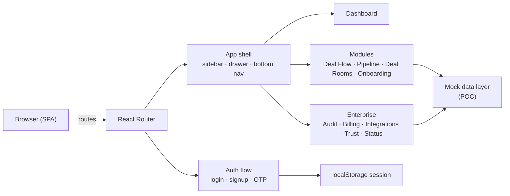

# AIIM

Annita Impact Innovation Hub (AIIM) — the ecosystem platform for founders, investors, and partners. **Enter Raw. Leave Funded.**

## Stack

- **Framework**: React 19 + Vite 6 (SPA, code-split, progressive enhancement)
- **Language**: TypeScript (strict)
- **Styling**: Tailwind CSS 4
- **Routing**: React Router 7
- **Auth (POC)**: In-memory + `localStorage` session with passkeys-forward UI; pluggable to Better Auth
- **AI**: Gemini integration wrapper (stubbed in this proof of concept)
- **Icons**: lucide-react
- **Fonts**: Geist (Google Fonts)

## Getting started

1. Install dependencies: `npm install`
2. Copy `.env.example` to `.env.local` and set values (e.g. `GEMINI_API_KEY`).
3. Run the dev server: `npm run dev`

The dev server binds the first free port (starting at 3000) and prints the URL.

## Scripts

| Command | Purpose |
| --- | --- |
| `npm run dev` | Start Vite dev server (HMR) |
| `npm run build` | Production build to `dist/` |
| `npm run preview` | Preview the production build |
| `npm run lint` | TypeScript `tsc --noEmit` |
| `npm run clean` | Remove `dist/` |

## Project layout

```text
src/
├─ App.tsx                 # Routes + guards + per-page SEO
├─ main.tsx                # Root render, ErrorBoundary, Suspense
├─ index.css               # Tailwind 4 theme (Annita One visual identity)
├─ components/
│  ├─ auth/                # Auth shell, card, password field, classes
│  ├─ brand/               # Logo + mark
│  ├─ layout/              # App shell (sidebar, top bar, drawer, bottom nav)
│  ├─ navigation/          # Nav items, sidebar, bottom nav, mobile drawer
│  ├─ module-placeholder/  # Shared empty/placeholder pattern
│  ├─ seo/                 # Per-route meta management
│  └─ ErrorBoundary.tsx    # Global crash boundary
├─ context/                # Auth + theme providers
├─ lib/auth/               # Auth client + device beacon
├─ pages/                  # All route pages (lazy-loaded)
├─ constants/              # Demo accounts, programs, payment data
└─ services/               # Gemini service wrapper
public/
├─ brand/                  # annita-mark.png, annita-logo.png
├─ favicon.png
├─ robots.txt
├─ sitemap.xml
├─ manifest.json
└─ sw.js
scope.md · prd.md · spec.md  Planning docs
```

## High-level architecture



## What it does (selection)

- **Deal flow** with AI match scoring (sector, stage, check size, geography, thesis) plus rationale and conflict checks
- **Pipeline** Kanban across Sourced → Closed with deal cards
- **Deal rooms** — permission-tiered vaults, NDA gating, activity, upload
- **Founders / investors / partners** profiles, mandates, challenges, pilots
- **Programs & events** — cohorts, matchmaking, capacity caps
- **Pilots & evaluations** — KPI tracking, scorecards, consensus, go/no-go decision records
- **Institutional memory** — searchable evaluation rationale over time
- **AI copilot** (Ask AIIM) over deal/diligence context
- **Enterprise surface** — audit log, billing & usage metering, integrations/API/webhooks, trust center, status, admin console
- **Idea management, technology scouting, open innovation, ROI & FP&A, stage-gate governance**
- **Notifications, messages, documents, analytics, security, help center, onboarding**

## Security posture

- Client security headers (`X-Content-Type-Options`, `Referrer-Policy`, `Permissions-Policy`) + CSP-friendly asset loading
- Route guards (`ProtectedRoute`, `PublicOnlyRoute`) and persisted sessions
- Global `ErrorBoundary` to prevent hard crashes; per-module empty/zero states
- `robots.txt` + `sitemap.xml` for SEO, public pages only
- Append-only audit mock + RBAC role model (admin / founder / investor / partner / member)
- Security documentation + Trust Center (SOC 2/ISO posture, SSO/SAML, SCIM readiness)

Next phase: SSO/SAML, KYC/KYB providers, SOC 2 Type II, real RAG backend, CI/CD and E2E tests.

## Conventions

- All authenticated pages live under the protected route guards; auth pages are public-only.
- Route components are lazy-loaded; keep pages default-exported.
- Per-page SEO metadata is declared via the `Seo` component.
- Mock data lives at module level; prefer empty/zero fallbacks when lists are empty.
- Tailwind 4 theme tokens live in `src/index.css`; brand palette is `annita-*` / `brand-*`.
- No secrets in source; copy `.env.example` → `.env.local`.

## Planning docs

- `scope.md` — project scope and vision
- `prd.md` — product requirements
- `spec.md` — technical specification

## License

See `LICENSE`.

---

Built with the Devpost Learn Skill Pack for the Build With AI: Basics hackathon. Production enterprise integrations, SSO/KYC/SOC 2 controls, and live AI backends are intended for the next phase.