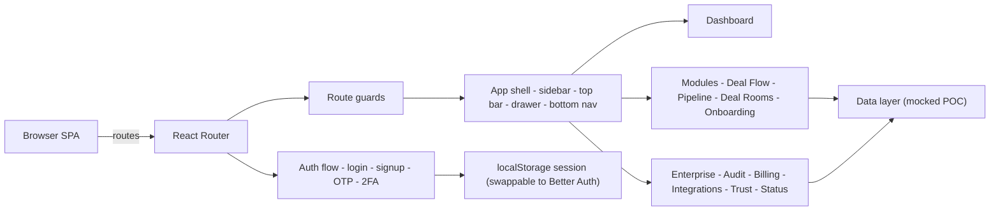
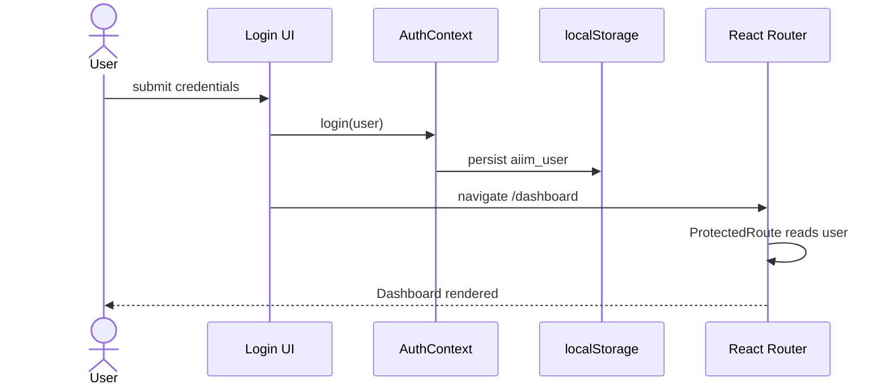
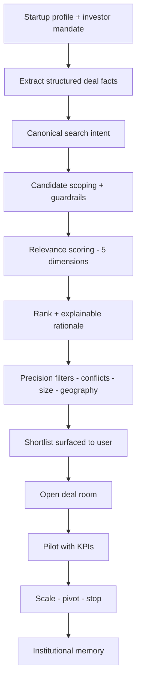

# AIIM — Annita Impact Innovation Hub

**Enter Raw. Leave Funded.**

AIIM is the ecosystem platform for founders, investors, ecosystem partners, accelerators, and universities. It covers the full innovation lifecycle: AI deal matching, deal rooms, pilot governance, institutional memory, onboarding, and enterprise integrations. Built as a proof of concept for the **Build With AI: Basics** hackathon using the Devpost Learn Skill Pack.

---

## Table of contents

1. [Overview](#overview)
2. [Architecture](#architecture)
3. [User journeys](#user-journeys)
4. [Module map](#module-map)
5. [Data model](#data-model)
6. [Security and compliance](#security-and-compliance)
7. [Getting started](#getting-started)
8. [Scripts](#scripts)
9. [Project layout](#project-layout)
10. [Planning docs](#planning-docs)
11. [Roadmap](#roadmap)

---

## Overview

AIIM connects three primary personas through a single governed platform:

- **Founders** — create profiles, run fundraising pipelines, open deal rooms, track pilots, build traction metrics.
- **Investors / VCs** — define mandates, receive AI-ranked deal flow, manage pipeline, perform diligence, track portfolio.
- **Partners / corporates / accelerators / universities** — post challenges, scout startups, run pilots, manage cohorts, report on outcomes.

Everything is AI-assisted (Gemini-backed in production; stubbed in this POC) and optimized for fast, secure, mobile-first experiences.

---

## Architecture

### System context



### Authentication and authorization flow



### Deal matching pipeline



---

## User journeys

### Founder journey

1. Sign up as founder (3-step: role, account, OTP).
2. Complete role-specific onboarding (company, problem, solution, metrics, fundraising).
3. View AI-matched investors in Deal Flow with explainable scores.
4. Manage pipeline (Kanban) across Sourced → Closed.
5. Open deal room, share docs, run diligence.
6. Track pilot KPIs; record go/no-go decision; institutional memory persists.

### Investor journey

1. Sign up as investor (mandate sectors, stages, check size, geography).
2. Receive ranked deal flow (top ~15 fits first).
3. Review rationale, conflicts, missing data.
4. Open data room, run diligence checklist.
5. Route to IC memo, term-sheet modeling, portfolio tracking.

### Partner journey

1. Sign up as partner (corporate, accelerator, university).
2. Post challenges; scout startups.
3. Run pilots with defined success metrics.
4. Report on outcomes; build institutional memory.

---

## Module map

| Module | Key capabilities |
| --- | --- |
| Auth & onboarding | Role selection, multi-step signup with OTP, per-role walkthrough, passkeys, 2FA |
| Dashboard | Role-aware KPIs, quick actions, personalized workspace |
| Deal Flow | AI match scoring, filters, rationale, deal room entry |
| Pipeline | Kanban by stage, deal cards, ownership, next actions |
| Deal Rooms | NDA-gated vaults, watermarking, upload, activity, Q&A |
| Founders / Investors / Partners | Profiles, mandates, challenges, pilots |
| Programs & events | Cohorts, mentorship, matchmaking with capacity caps |
| Pilots & evaluations | KPI tracking, scorecards, consensus, go/no-go records |
| Institutional memory | Searchable evaluation rationale over time |
| Idea management | Idea capture, AI dedup, coaching, alignment scoring |
| Technology scouting | Conversational AI search, snapshots, trend reports |
| Open innovation & RFI | External challenges, RFI workflows, engagement |
| ROI & FP&A | Budget vs. spend, milestone-gated funding, probability risk |
| Stage-gate governance | Automated gates, SLAs, audit trail |
| Admin console | Verification queue, users, platform health, governance |
| Audit log | Append-only trail with actor, resource, IP, time |
| Billing & usage | Plan, invoices, usage metering, alerts |
| Integrations & API | Connectors, public API, webhooks with retries |
| Trust center / status | Security docs, certifications, service health |
| Ask AIIM | AI copilot for market intel and diligence |
| Notifications / messages / docs | Alerts, threads, file vault |
| Analytics / search / help | Funnels, semantic search, KB |

---

## Data model (POC)

```mermaid
erDiagram
  USER ||--o{ ORGANIZATION : belongs_to
  USER ||--o{ PROFILE : has
  PROFILE ||--o{ DEAL : submits
  INVESTOR ||--o{ MANDATE : defines
  DEAL ||--o{ MATCH : scored_against
  MATCH ||--o{ DEAL_ROOM : opens
  DEAL_ROOM ||--o{ DOCUMENT : contains
  DEAL_ROOM ||--o{ PILOT : leads_to
  PILOT ||--o{ EVALUATION : records
  EVALUATION ||--o{ DECISION : produces
  DECISION --> INSTITUTIONAL_MEMORY : persists
  USER ||--o{ NOTIFICATION : receives
  USER ||--o{ MESSAGE : sends
```

Every record carries: id, createdAt, updatedAt, tenantId, ownerId, audit trail.

---

## Security and compliance

- Role-based route guards (`ProtectedRoute`, `PublicOnlyRoute`) and persisted sessions
- Passkey + password + OTP-ready UI; 2FA hooks
- RBAC roles: admin, founder, investor, partner, school-admin, member
- Append-only audit (mock) with actor, action, resource, IP, timestamp, result
- Trust center documenting SOC 2/ISO posture, SSO/SAML, SCIM readiness
- Data export, tenant isolation below the application layer
- Client security headers: `X-Content-Type-Options`, `Referrer-Policy`, `Permissions-Policy`
- SEO hardening: canonicals, robots.txt, sitemap.xml, structured data (JSON-LD)

Next phase: SSO/SAML providers, KYC/KYB, SOC 2 Type II, real RAG backend, E2E tests.

---

## Getting started

Prerequisites: Node.js 18+.

```bash
npm install
npm run dev
```

The dev server binds the first free port (starting at 3000) and prints the URL.

## Scripts

| Command | Purpose |
| --- | --- |
| `npm run dev` | Start Vite dev server (HMR) |
| `npm run build` | Production build to `dist/` |
| `npm run preview` | Preview the production build |
| `npm run lint` | TypeScript `tsc --noEmit` |
| `npm run clean` | Remove `dist/` |

## Project layout

```text
src/
├─ App.tsx                 # Routes + guards + per-page SEO
├─ main.tsx                # Root render, ErrorBoundary, Suspense
├─ index.css               # Tailwind 4 theme (Annita visual identity)
├─ components/
│  ├─ auth/                # Auth shell, card, password field, classes
│  ├─ brand/               # Logo + mark
│  ├─ layout/              # App shell, top bar, drawer, bottom nav
│  ├─ navigation/          # Nav items, sidebar, bottom nav, mobile drawer
│  ├─ module-placeholder/  # Shared empty/placeholder pattern
│  ├─ seo/                 # Per-route meta management
│  └─ ErrorBoundary.tsx    # Global crash boundary
├─ context/                # Auth + theme providers
├─ lib/auth/               # Auth client + device beacon
├─ pages/                  # All route pages (lazy-loaded)
├─ constants/              # Demo accounts, programs, payment data
└─ services/               # Gemini service wrapper
public/
├─ brand/                  # annita-mark.png, annita-logo.png
├─ favicon.png
├─ robots.txt
├─ sitemap.xml
├─ manifest.json
└─ sw.js
scope.md · prd.md · spec.md  Planning docs
```

## Planning docs

- `scope.md` — project scope and vision
- `prd.md` — product requirements
- `spec.md` — technical specification

## Roadmap

- SSO/SAML + SCIM against Okta/Azure AD/Google Workspace
- KYC/KYB providers for investors, founders, partners
- Real RAG backend over verified company + diligence data
- Live deal-room Q&A with document embeddings
- Pilot KPI automation and stage-gate triggers
- Usage-based metering + invoice automation
- Observability, E2E tests, accessibility automation, i18n (Africa-first locales)

## License

See `LICENSE`.

---

Built with the Devpost Learn Skill Pack for the Build With AI: Basics hackathon. Production enterprise integrations, SSO/KYC/SOC 2 controls, and live AI backends are intended for the next phase.